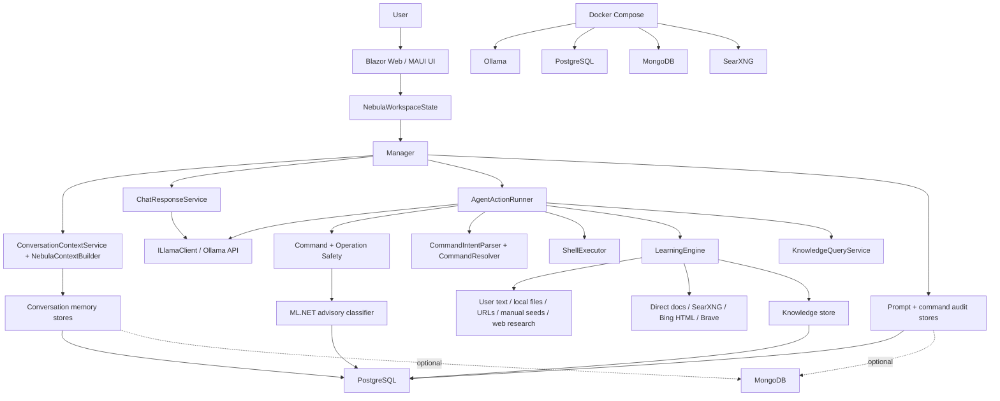

# AGENTS.md - Nebula Repository Guide

Last verified: 2026-11-03 (central log redaction; full solution build and tests
re-run) on integration branch `reconcile/b-into-a-20261025`.

This guide is for coding agents working in the Nebula repository. It is based on
the current code, project files, docs, tests, Docker files, and local validation
commands. Do not treat roadmap notes as implemented behavior unless the current
code also supports them.

## Table of Contents

1. [Project Identity](#project-identity)
2. [Capability Status](#capability-status)
3. [Repository Map](#repository-map)
4. [Architecture](#architecture)
5. [Runtime Lifecycle](#runtime-lifecycle)
6. [Execution Modes](#execution-modes)
7. [Agent Loop and Tool Execution](#agent-loop-and-tool-execution)
8. [Safety Model](#safety-model)
9. [LLM and Ollama Integration](#llm-and-ollama-integration)
10. [Persistence](#persistence)
11. [Research and Learning](#research-and-learning)
12. [UI Applications](#ui-applications)
13. [Configuration and Environment](#configuration-and-environment)
14. [Docker and Local Services](#docker-and-local-services)
15. [Build, Test, and Run Commands](#build-test-and-run-commands)
16. [Coding Conventions](#coding-conventions)
17. [Common Tasks](#common-tasks)
18. [Known Limitations and Human Confirmation](#known-limitations-and-human-confirmation)
19. [Files to Handle Carefully](#files-to-handle-carefully)
20. [Glossary](#glossary)

## Project Identity

Nebula is a local-first assistant and agent system built on .NET 10. It combines:

- A Blazor web UI and a MAUI shell for conversation and agent interactions.
- A local Ollama-compatible LLM client.
- Explicit Chat and Agent modes.
- A ReAct-style action loop for agent mode.
- Command execution with deterministic safety policy and optional ML.NET advisory classification.
- PostgreSQL-backed prompt, conversation, command, knowledge, and ML model storage.
- Optional MongoDB prompt/conversation storage.
- Offline-first learning plus optional free web research through direct documentation,
  SearXNG, Bing HTML scraping, and optional Brave Search.
- Docker Compose support for Ollama, MongoDB, PostgreSQL, and SearXNG.

Primary language in much of the UI/docs is Portuguese. This file is intentionally
written in English because it is an operational guide for future agents.

## Capability Status

Use these categories when describing Nebula:

- **Implemented**: supported by current code and covered by real entry points or tests.
- **Partial**: real code exists, but integration, persistence, UI, or validation is incomplete.
- **Planned**: present in `plan.md` or docs only.
- **Legacy/experimental**: present, but not the current main path or not fully wired.
- **Not found**: searched for and not present in the current repository state.

| Area | Status | Evidence |
| --- | --- | --- |
| Chat mode | Implemented | `InteractionMode.Chat`, `Manager`, `ChatResponseService`, `NebulaContextBuilder`, UI selector in `Nebula.App.Shared/Pages/Chat.razor`. |
| Agent mode | Implemented | `InteractionMode.Agent`, `AgentActionRunner`, `AgentActionSession`, ReAct JSON decision flow, execution history, evidence, retries, approvals. |
| ReAct planning/execution loop | Implemented | `AgentActionRunner.RunAsync`, `GenerateDecisionAsync`, `ExecuteActionAsync`, retry and failure paths in tests. |
| Shell command execution | Implemented | `ShellExecutor`, `CommandResolver`, `RuntimeCommandEnvironmentDetector`, `InteractivePromptDetector` (encerra comandos que esperam input manual com mensagem clara e exit code -1), command tests. |
| File read/write operations | Implemented | `OperationKind.FileRead`, `OperationKind.FileWrite`, `ExecuteFileReadAsync`, `ExecuteFileWriteAsync`, operation safety tests. |
| Script content and script execution | Implemented with safety limits | `OperationKind.ScriptContent`, `OperationKind.ScriptExecution`, `ScriptContentSafetyClassifier`, `SessionArtifactPolicy`. |
| Human approval | Implemented | UI approves pending terminal/script/file/patch actions with a scope selector; the approved action continues as a new run (`RunApprovedCommandAsync`) without another LLM decision, and `ParentRunId` links it to the originating run. The CLI approval loop handles continuation prompts (max 10 rounds per turn). Approval records persist in `agent_approvals`. |
| Approved-action continuation | Implemented | `AgentRunOrchestrator.RunApprovedCommandAsync` replays the approved action without calling the LLM; `IAgentRunStore.GetRunIdByStepIdAsync` resolves the originating run and `AgentActionRunRequest.ParentRunId` is persisted in `agent_runs.ParentRunId` (migration `add_agent_run_parent_run_id`). Resumed runs also link to the resumed run. UI history shows a parent link. |
| Approval override service | Implemented | `ICommandApprovalService`/`CommandApprovalService` (`ApprovalOverrideSource` None/Manual/Conversation/Workspace/Category/Auto, `ApprovalOverrideInput`, `ApprovalScope` Once/Conversation/Workspace/Category, `EvaluateOverride` com precedencia Manual > Conversation > Categoria > Auto); `ApprovalOverrideResult.CanProceed`; overridable kinds sao `TerminalCommand`, `ScriptExecution`, `FileRead`; categorias via `CategorizeIntent` (package-install, network-access, privileged-operation, destructive-operation, data-exfiltration, read-only, write-local, execute-local, blocked, needs-approval); normalizacao de comando compartilhada `CommandNormalization.Normalize` (lowercase + espacos colapsados). |
| Granular approval scope | Implemented | `ApprovalScope` no `AgentApprovedAction` + select na UI (Once/Conversation/Workspace/Category): Once aprova so a acao; Conversation rastreia comandos por conversa em memoria no `Manager` (`approvedCommandsByConversation` -> `ConversationApprovedCommands` no request -> `AgentActionSession.ApprovedCommandsForConversation`); Workspace salva o comando na allowlist do workspace (mesma persistencia/`AddAsync` do allowlist) e nota "Aprovado manualmente e salvo na allowlist deste workspace."; Category adiciona a categoria as categorias auto-aprovadas DO workspace (`IWorkspaceCategoryPolicyService`), nao global, e nota "Aprovado manualmente; a categoria 'x' agora e auto-aprovada neste workspace.". |
| Per-workspace auto-approve categories | Implemented | `IWorkspaceCategoryPolicyService`/`WorkspaceCategoryPolicyService` (categorias auto-aprovadas por workspace, kind `WorkspaceMemoryKind.AutoApprovedCategory` na tabela `workspace_memory`, normalizacao `CommandNormalization.Normalize`, `AddAsync` idempotente); no runner (`AgentActionRunner.TryApplyApprovalOverrideAsync`) as categorias do workspace sao carregadas (`ListAsync`) e combinadas com as globais (`NebulaRuntimeSettings.AutoApproveCategories`) na avaliacao do override (`ApprovalOverrideInput.WorkspaceAutoApproveCategories`, check unificado no `CommandApprovalService.EvaluateOverride`); registro via DI nas 3 raizes (`AddScoped`); UI: campo em `Settings.razor` + `NebulaWorkspaceState.LoadWorkspaceCategoriesAsync`/`AddWorkspaceCategoryAsync`. |
| Auto-approval | Partial | `NebulaRuntimeSettings.AutoApproveCommands` is supported; use only in trusted development scenarios. Categorias explicitas (`AutoApproveCategories`) sao o caminho preferido de auto-aprovacao seletiva. |
| Command deduplication | Implemented | `CommandDeduplication` in `Nebula.Agent/Domain/ExecutionHistory.cs` blocks repeated success or repeated failures when the normalized command and workspace (file/environment fingerprints) are unchanged; explicit retry justification allows. |
| Workspace memory | Implemented | `IWorkspaceMemoryStore`/`WorkspaceMemoryService` (`WorkspaceMemoryKind` WorkingCommand/UsedPort/Script/Note/AllowlistedCommand/Strategy), stores `PostgresWorkspaceMemoryStore` (table `workspace_memory`, unique `{workspace, kind, key}`) and `InMemoryWorkspaceMemoryStore`; successful commands (exit 0) are recorded, ports detected via regex `(?:localhost\|127\.0\.0\.1):(\d{2,5})`, and memory summary feeds the decision prompt. |
| Per-workspace command allowlist | Implemented | `ICommandAllowlistService`/`CommandAllowlistService` (comandos frequentes do workspace — build, test, format, lint, migrations — que pulam a aprovacao para aquele workspace); persiste em `workspace_memory` via `WorkspaceMemoryKind.AllowlistedCommand` (normalizacao: lowercase + espacos colapsados, `AddAsync` idempotente, `ListAsync` por workspace); no runner (`AgentActionRunner.TryApplyWorkspaceAllowlist`) so derruba decisoes `AskApproval` de `TerminalCommand`/`ScriptExecution` apos o fluxo de override manual/auto (que tem prioridade), marca `AutoApproved=true` e nota "Aprovado pela allowlist deste workspace" (nota preservada por `ApplyToolResult` via `AppendApprovalNote`); registro via DI nas 3 raizes (`AddScoped`); UI: campo em `Settings.razor` + `NebulaWorkspaceState.LoadAllowlistAsync`/`AddAllowlistCommandAsync` usando `ResolvedWorkspace.Root`. |
| Strategy memory per stack/error | Implemented | `WorkspaceMemoryKind.Strategy` (persistido em `workspace_memory`, mesmo unique `{workspace, kind, key}`); `WorkspaceMemoryService.RecordWorkingStrategyAsync` grava o comando que resolveu (limite 400 chars, dedupe via `ExistsAsync`, chave `{stackLabel}|{errorSignature}` normalizada lowercase, stack detectado por `DeterministicStackDetector`) e `BuildStrategiesSummaryAsync` monta bloco "Estrategias que ja funcionaram neste workspace (stack atual: ...)" usado no decision prompt; no runner (`AgentActionRunner.TryRecordWorkingStrategyAsync`) e registrado quando um comando diferente da tentativa anterior (falha) termina com exit 0. |
| Architecture comparison before large changes | Implemented | `architectureComparison` no JSON de decisao: `ArchitectureOption` (name/pros/cons/recommendation/risk, enum low/medium/high/critical) no schema; sessao `ApplyArchitectureComparison` emite evento `ActionExecutionEventKind.ArchitectureComparison` e expoe `ArchitectureOptions` na `ConversationTurn`; prompt orienta comparar >= 2 opcoes antes de mudancas grandes (novo modulo/refactor) e omitir em mudancas pequenas; bloco "## Comparacao de arquitetura" no `FinalReport`; UI: card "Comparacao de arquitetura" na side rail com destaque de risco alto/critico. |
| Structured plan JSON | Implemented | `AgentActionDecision.Plan` + `AgentPlanStep` (id/description/dependsOn/status/risk/isCheckpoint); session `ApplyPlan`/`MarkPlanStepCompleted`/`BuildCurrentPlan` renders `#id [status] [checkpoint] [risk=X] (depends on x)`; `plan` property in decision JSON schema; prompt instructs decomposition into subtasks with checkpoints and per-step risk estimation; UI highlights checkpoints (◆) and high/critical risk steps. |
| Per-step risk and checkpoints | Implemented | `AgentPlanStep.Risk` (low/medium/high/critical, `NormalizeRisk` em `ApplyPlan`) + `AgentPlanStep.IsCheckpoint`; render `[risk=X]`/`[checkpoint]` no `BuildCurrentPlan`; classes `nebula-mission-item--checkpoint/--risk` na UI; prompt orienta decomposicao em subtarefas com checkpoints determinísticos e estimativa de risco por etapa. |
| Dry run / preview mode | Implemented | `UserMessage.IsDryRun` -> `ManagementRequest` -> `AgentActionRunRequest.DryRun` -> `AgentActionSession.IsDryRun`; loop do `AgentActionRunner` faz `PreviewActionAsync` (resolucao + classificacao real de seguranca + `OperationPolicyEngine`, sem executar/escrever) ate `CompleteDryRun`; prompt ganha secao "DRY RUN MODE"; turno e comandos marcados `IsDryRun`; atalhos de knowledge/learning/research sao ignorados no dry run; UI: botao "Prever" ao lado de Enviar + badge "Previa (nada executado)". |
| Streaming tool output to UI | Implemented | `IShellOutputObserver`/`IStreamingShellExecutor` (`ShellExecutor` streams stdout/stderr line by line), `session.EmitStreamOutput` fuses consecutive lines per command, `ActionExecutionEventKind.StreamOutput` rendered as agente evento na UI. |
| Deterministic command safety | Implemented | `DeterministicCommandClassifier`, `CommandPolicyEngine`, `OperationPolicyEngine`, safety matrix tests. |
| ML.NET command safety classifier | Implemented as advisory | `MlNetCommandClassifier`, `CommandSafetyTrainer`, `PostgresMlModelStore`. ML never authorizes execution by itself. |
| PostgreSQL persistence | Implemented | `PostgresContext`, EF migrations, stores for prompts, conversations, commands, knowledge, fetched pages, ML artifacts. |
| Graceful MAUI Postgres initialization | Implemented | `MauiDatabaseInitializationService` starts migrations in the background after `builder.Build()`; `DatabaseInitializationRetry` retries with exponential backoff (fresh scope per attempt); `DatabaseInitializationState` drives a banner and manual retry in `MainLayout`; retry/state tests cover success, exhaustion, delay cap, cancellation, and state transitions. The `net10.0-android` build is validated; manual banner/retry validation on an emulator/device remains pending. |
| MongoDB persistence | Legacy/complementary | Mongo prompt/conversation stores exist and are conditionally registered after a ping. PostgreSQL is the durable primary path in current app setup. |
| Conversation history/context | Implemented | `ConversationContextService`, `NebulaContextBuilder`, conversation state/message repositories. |
| Persistent agent run/task session store | Implemented | `AgentRun`/`AgentStepRecord`/`AgentArtifactRecord`/`AgentApprovalRecord` + `IAgentRunStore`/`PostgresAgentRunStore` (tables `agent_runs`, `agent_step_records`, `agent_artifacts`, `agent_approvals`), checkpoints no meio do loop, `GetUnfinishedRunsAsync`, `GetRunIdByStepIdAsync`; `agent_runs.WorkspaceRoot` (migração `add_agent_run_workspace_root`) restaurado em `Manager.ResumeTaskAsync`; `agent_runs.ParentRunId` (migração `add_agent_run_parent_run_id`) liga continuacoes ao run de origem. |
| Learning from local/user sources | Implemented | `LearningEngine`, `LearningOrchestrator`, `LearningSourceReader`, knowledge tests. |
| RAG no Chat mode | Implemented | `ConversationContextService.AugmentWithKnowledgeAsync` injeta conhecimento armazenado (`IKnowledgeQueryService.AnswerAsync`) no `ModelPrompt` do Chat como bloco `[knowledge]` (max 3000 chars, truncado), somente em `InteractionMode.Chat`; log `[CHAT] Injected ...`; falha nao fatal volta ao prompt original. |
| LLM como extractor no path padrao | Implemented | `IKnowledgeExtractor` nos 3 roots e registrado como `LlamaKnowledgeExtractor` (via DI factory) com `fallbackExtractor: new KnowledgeExtractor()` deterministico; se o LLM falhar (offline, JSON invalido) cai no fallback determinístico. |
| User memory | Implemented | `UserMemoryKind` (Language/Style/DetailLevel/AutonomyTolerance) em `Nebula.Core/Memory/UserMemory.cs`, `IUserMemoryStore`/`PostgresUserMemoryStore` (tabela `user_memory`, unique `{userId, kind, key}`, migração `add_user_memory`) e `InMemoryUserMemoryStore`; `UserMemoryService` (`Nebula.Agent/Application/UserMemoryService.cs`) com get/set por `userId`; `NebulaRuntimeSettings.UserId` define o usuário atual (snapshot em ambos os sentidos); Chat injeta seção `[user_preferences]` via `ConversationContextService.AugmentWithUserPreferencesAsync` (somente Chat; sem preferências não injeta) e o Agent ganha bloco no decision prompt via `BuildUserPreferencesAsync` (defaults resumidos; omite se vazio); UI: seção "Preferencias do usuario" em `Settings.razor` com selects salvos via `NebulaWorkspaceState.SaveUserPreferencesAsync`. |
| Busca semantica local (knowledge + projeto) | Implemented | `IKnowledgeSearchService`/`KnowledgeSearchService` (`Nebula.Services/Learning/KnowledgeSearchService.cs`): busca deterministic por overlap de tokens sobre `IKnowledgeStore` (ranking por tokens, tags, fonte, mapeado para o score de confiança relacionado) e sobre arquivos do workspace (`SearchProjectAsync`: ignore de `bin/obj/node_modules/.git`, hierarquia de diretório, limites de arquivos/tamanho, snippets); `IKnowledgeQueryService.AnswerForAutomationAsync` continua sendo o caminho de injeção automatica no planner (`AgentActionRunner.QueryRelevantKnowledgeAsync`); o runner usa o search para enriquecer observações (`AugmentFailureWithKnowledgeAsync`). |
| Indexacao de documentacao do projeto | Implemented | `IProjectDocumentationIndexer`/`ProjectDocumentationIndexer` (`Nebula.Services/Learning/ProjectDocumentationIndexer.cs`): escaneia README + `*.md` do workspace (máx. 15 arquivos / 100 KB, pula bin/obj/node_modules/.git), extrai preambulo, seções, code blocks e comandos inline e persiste `KnowledgeItem` determinísticos (Kind Concept/CodeSnippet/Command, tags `project-docs`, hash idempotente via `KnowledgeHash.Create` + `FindByHashAsync`, itens SourceOnly, `SourceUrl file://`); hook `TryIndexProjectDocumentationAsync` roda no início de cada run do agente (`RunCoreAsync`, depois do `ActionRequestValidator`) e há botão "Indexar documentacao" na UI do result (usa `IKnowledgeRepository`, registrado nos 3 roots). |
| Aprendizado pos-tarefa via sintese LLM | Implemented | `IPostTaskLearningService`/`PostTaskLearningService` (`Nebula.Agent/Application/PostTaskLearningService.cs`): apos `session.Complete` no `RunCoreAsync`, hook `TryLearnFromPostTaskAsync` monta `PostTaskRunSnapshot` (comandos bem-sucedidos + artefatos criados), sintetiza resumo com o LLM (`LlamaKnowledgeExtractor`-style, com fallback deterministico) e persiste `KnowledgeItem` Kind `Procedure` (tags `task-summary,post-task,auto-learned`) via `IKnowledgeStore.SaveAsync`; hook nao-fatal (try/catch). |
| Revalidacao de conhecimento antigo | Implemented | `KnowledgeQueryService` (default offset de 90 dias via `stalenessThreshold`): `AnswerForAutomationAsync` exclui itens stale (`LastSeenAt` antigo) e avisa que existem itens desatualizados; `AnswerAsync` (Chat) mantem itens stale mas adiciona linha "Alerta: conhecimento desatualizado"; teste em `KnowledgeAutomationLearningTest`. |
| Automation policy ligada | Implemented | `IKnowledgeAutomationPolicy`/`KnowledgeAutomationPolicy` agora e consultada: `IKnowledgeQueryService.AnswerForAutomationAsync` filtra por `CanUseAutomatically` (FinalScore >= 0.75, nao-dangerous) e `AgentActionRunner.QueryRelevantKnowledgeAsync` usa essa rota para injetar conhecimento automatico no planner do Agent. |
| Result validation, environment checks, and error recovery | Implemented | `ResultValidator` valida evidencias com o LLM e pode propor uma acao corretiva; ela entra no retry normal da sessao com `RequiresSafetyReview=true`, portanto continua sujeita aos classificadores e politicas. `EnvironmentValidator` fornece avisos advisory antes da execucao, controlado por `Nebula:EnableEnvironmentValidation`. `ErrorFixService` agrega estrategias do workspace, conhecimento e sugestoes deterministicas. As validacoes podem ser desligadas por `Nebula:EnableResultValidation` e `Nebula:EnableEnvironmentValidation`; `MaxConsecutiveErrorRetries` limita repeticoes do mesmo erro. |
| Web research | Implemented | Direct docs, SearXNG, Bing HTML, Brave optional, configurable/free providers. |
| Safe experiment runner | Partial | `ISafeExperimentRunner` and `SafeExperimentRunner` exist, but the current learning orchestrator records source-only experiments instead of invoking it. |
| Project templates/scaffolding | Implemented | `IProjectTemplateCatalog`/`ProjectTemplateCatalog` (dotnet-console, dotnet-api, python-script, python-package, node-cli), `IProjectScaffolder`/`ProjectScaffolder` (raiz restrita a workspace/temp), `OperationKind.ProjectScaffold` + `AgentToolAction.TemplateId` + JSON schema, dispatch em `ExecuteProjectScaffoldAsync`. |
| Workspace map | Implemented | `IWorkspaceMapService`/`WorkspaceMapService` indexa arquivos, modulos, testes, dependencias e comandos conhecidos; `BuildSummary` injetado no decision prompt; `IProjectStackValidator` valida arquivos essenciais por template. |
| Reference workspace | Implemented | `ReferenceWorkspace.Resolve` (`Nebula.Core/Projects/ReferenceWorkspace.cs`) define a pasta do projeto em que o agente trabalha: caminho explicito e criado quando faltar (mesmo vazio) ou workspace novo vazio em `%TEMP%/nebula-workspace/<conversationId>` quando nada for especificado (raiz explicita e usada como esta); `NebulaRuntimeSettings.WorkspaceRoot` (config `Nebula:WorkspaceRoot`, env `NEBULA_WORKSPACE_ROOT`) → `UserMessage.WorkspaceRoot` → `ConversationRequest` → `AgentActionRunRequest.WorkspaceRoot` → `AgentActionSession.WorkspaceRoot`; o runner usa o workspace resolvido no lugar de `Environment.CurrentDirectory` (detecção de operação, ambiente, `ResolveSessionWorkingDirectory`, workspace map/memory no decision prompt); `AgentRun.WorkspaceRoot` persistido em `agent_runs.WorkspaceRoot` (migração `add_agent_run_workspace_root`) e restaurado em `Manager.ResumeTaskAsync`; UI: campo em `Settings.razor` + `QuickSettings.WorkspaceRoot` persistido em `nebula.quick-settings.v1` + `WorkspaceState.ResolvedWorkspace`. |
| Action path validation | Implemented | `AgentActionRunner.ValidateDecision` rejects control characters in `targetPath`/`workingDirectory`/`PlannedFiles[].RelativePath`, normalizes Windows-style relative separators (`NormalizePathSeparators`), and rejects drive-rooted relative paths; `PlannedPatchApplier` applies the same checks and never falls back to the process cwd when a target is invalid. |
| Database migrations with explicit approval | Implemented | `OperationKind.Migration` + `AgentToolAction.MigrationAction/MigrationFramework/MigrationName/MigrationContext`; `AgentActionRunner.ExecuteMigrationAsync` runs `Create`/`Apply` only after a manual `AgentApprovedAction` (scope forced to `Once`) and never through auto-approve, allowlist, conversation or category scopes; `List` is read-only and allowed. `MigrationService` supports EF Core and Node.js, validates names/contexts, and `DryRun` returns the planned command without executing. See `Nebula.Agent/Infrastructure/MigrationService.cs` and `Nebula.Core/Agent/MigrationContracts.cs`. |
| Multi-file planned patches | Implemented | `OperationKind.PlannedPatch` + `AgentToolAction.PlannedFiles` (`plannedFiles` [{path, content}] no JSON de decisao), `IPlannedPatchApplier`/`PlannedPatchApplier` (raiz restrita a workspace/temp, arquivos relativos ao target, path traversal bloqueado, sem fallback para o cwd em caminho invalido), validacao de conteudo (`PlannedPatchContentValidator`) e classificacao agregada por arquivo (`FileWriteSafetyClassifier`); extensao de script ou arquivo fora das raizes pedem aprovacao antes de aplicar (revisao visivel nas Notes do card). |
| Self-programming loop (DoD, lint/format, timeouts, diff review, overwrite guard, repair loop) | Implemented | `RequireDeterministicVerification` (gate no `VerifyCompletionDeterministicallyAsync`), `WorkspaceStack.LintCommand` (`.NET` `dotnet format --verify-no-changes --no-restore`; Node `npm run lint` quando o script existe; falha reprova o DoD e `dotnet format` e permitido pela policy para corrigir), `CommandTimeoutSeconds`/`ScriptTimeoutSeconds` (`CreateToolCancellationToken` com falha clara e retry), `IGitDiffService`/`GitDiffService` (read-only: `rev-parse`, `diff --name-only`, `diff --stat`) com secoes de diff e aviso de alteracoes fora da acao no `FinalReport`, `ConcurrentModificationGuard` (arquivo alterado apos `RunStartedUtc` pede aprovacao antes de sobrescrever, incluindo patches), `MaxVerificationRetries` (repair loop: falha do DoD volta para o agente corrigir; limite de correcoes seguidas configuravel). |
| Optional per-workspace container sandbox | Implemented | `SandboxMode` (`Disabled`/`Docker`, default `Disabled`) em `NebulaRuntimeSettings` + `ICommandSandbox`/`DockerCommandSandbox` (`Nebula.Runner/CommandSandbox.cs`); comandos `TerminalCommand`/`ScriptExecution` que a policy marcaria como `AskApproval` (sem override manual/auto) executam isolados quando habilitado: `docker`/`podman run --rm --network none --cap-drop ALL --security-opt no-new-privileges` + limites opcionais `SandboxMemoryLimitMb`/`SandboxCpuLimit`, bind do workspace como `/workspace:rw` (Podman no Linux usa `:rw,Z`), imagem default `mcr.microsoft.com/powershell:lts`; `SandboxRuntime` (`Auto`/`Docker`/`Podman`) e resolvido por `ISandboxRuntimeLocator`/`SandboxRuntimeLocator` (Auto prefere Docker e depois Podman; runtime explicito nao faz fallback) e a ausencia de runtime falha antes da execucao, sem cair para o host; antes de rodar, desembrulha wrappers host (`powershell -Command "..."`/`bash -c "..."`) e traduz paths absolutos do workspace para `/workspace`; com sandbox habilitado, criacoes de arquivos (`FileWrite`/`PlannedPatch`) com alvo no workspace sao permitidas automaticamente (a execucao isolada ocorre no container), mas material sensivel (`.env`, credenciais, tokens), alvos fora do workspace/temp e o guard de modificacao concorrente continuam exigindo aprovacao ou bloqueio; shells inelegiveis (Cmd/Unknown) e o restante do fluxo de aprovacao continuam como antes; `CommandExecution.Sandboxed` marca a execucao. Settings: `Nebula:Sandbox:Mode|Runtime|Image|MemoryLimitMb|CpuLimit` (web/CLI) e `NEBULA_SANDBOX_MODE|RUNTIME|IMAGE|MEMORY_LIMIT_MB|CPU_LIMIT` (MAUI). |
| Sandbox settings persistence and profile policy | Implemented | Settings UI ("Sandbox de comandos") exposes mode/image/memory/CPU/scope; `ISandboxSettingsStore`/`PostgresSandboxSettingsStore` persist `sandbox_settings` keyed by `(UserId, Workspace)` with global fallback (`Workspace = ""`); `NebulaWorkspaceState` applies localStorage v1 (ignoring sandbox fields when `SandboxConfigured` is false), then DB exact/global overrides, otherwise server/env defaults, and saves DB + localStorage (DB failure is non-fatal; saving scope global deletes the workspace override); `NebulaRuntimeSettings.SandboxModeFloor` comes from server `Nebula:Sandbox:Mode` and `ResolveSandboxMode` prevents Conservative/Standard from disabling Docker while Autonomous/Lab may override it; sandbox images are restricted to Docker-reference characters (no leading `-`, whitespace, or shell metacharacters) and invalid values fall back to the default image; migration `add_sandbox_settings`; DI in Web/MAUI; tests cover policy, floor, snapshot, store roundtrip/fallback/upsert/delete and Settings UI. |
| Container sandbox sidecar (compose) | Implemented | `Nebula.Sandbox` exposes authenticated `/run` and `/health`; Web/CLI use `Nebula:Sandbox:SidecarUrl`/`SidecarToken` to delegate sandbox execution, while `docker-compose.sandbox.yml` runs the sidecar with the host runtime socket and `${HOME}/nebula-tmp:/tmp:z`; the sidecar maps `/tmp` to the host root and mounts the host path into the execution container, so scripts created by the agent in its workspace can run without mounting a socket into `nebula-web`. Sidecar requires `NEBULA_SANDBOX_TOKEN` and an active socket (`NEBULA_SANDBOX_RUNTIME`/`NEBULA_SANDBOX_SOCKET`; default rootless Podman), runs as `1000:1000` with `userns_mode=keep-id`, and uses `label=type:container_runtime_t` for the socket mount; `/health` probes the runtime. Docker overrides identity/userns/SELinux via `NEBULA_SANDBOX_USER`/`NEBULA_SANDBOX_USERNS_MODE`/`NEBULA_SANDBOX_SECURITY_OPT`. |
| Dedicated Agent Run screen | Implemented | `/agent-run/{RunId}` page (`AgentRunLive.razor`) with 3-panel layout: Plan (left), Terminal (center), Artifacts (right). Real-time event streaming via `IAgentRunOrchestrator.SubscribeAsync`. Live plan updates, ANSI terminal output, artifact actions, and a parent-run link for continuations. |
| Real-time command status | Implemented | `CommandCard` component shows pending/executing/passed/failed/blocked/awaiting-approval badges. `TerminalOutput` streams stdout/stderr with ANSI colors. |
| Command approval from card | Implemented | `CommandCard` has inline approval with scope selector (Once/Conversation/Workspace/Category). `CanApprove` gating via `WorkspaceState.CanApproveCommand`. |
| Command editing before approval | Implemented | `CommandCard` edit mode with textarea, `OnEdit`/`OnCancelEdit` callbacks, `ApproveCommand` uses edited value. |
| Policy decision explanation | Implemented | `CommandCard` shows safety decision badge, intent, classification source. `TimelineEventItem` renders classification reasons. Policy simulator in Settings. |
| Timeline with filters | Implemented | `AgentRunTimeline` component with search, kind filter (all `ActionExecutionEventKind`), status filter (all `ActionExecutionStatus`), errors-only toggle. Used in Chat and AgentRunLive. |
| Artifacts panel | Implemented | `ArtifactPanel` component shows files/scripts/logs with type icons, copy path, open actions. Integrated in Chat side rail and AgentRunLive. |
| Compact mode | Implemented | `TerminalOutput.CompactMode` (last 50 lines), Chat composer toggle, `QuickSettings.CompactMode` persisted in localStorage. `data-compact` attribute on agent turns. |
| Reusable Blazor components | Implemented | `CommandCard`, `StepCard`, `AgentRunTimeline`, `TimelineEventItem`, `ArtifactPanel`, `PlanView`, `TerminalOutput`, `TerminalLine` in `Nebula.App.Shared/Components/`. Used in Chat, AgentRuns, AgentRunLive, Settings. |
| Typed progress events / background worker | Implemented | `AgentRunEvent` hierarchy (16 event types), `IAgentRunEventPublisher`/`ChannelAgentRunEventPublisher`, `IAgentRunQueue`/`AgentRunBackgroundService` (BackgroundService), `IAgentRunOrchestrator`/`AgentRunOrchestrator`. Real-time streaming to UI. |
| OpenClaw integration | Not found | No `OpenClaw` references were found outside the user request. |
| Redis/SQLite/queues/background worker | Partial | `BackgroundService`/`IHostedService` implemented via `AgentRunBackgroundService` for agent run queue. No Redis, SQLite, Hangfire, Quartz, or general queue worker. |
| Git workspace operations and PR | Partial | `GitService` covers diff/status/branch/commit/amend/revert by commit/log/remotes; commit-message generation is wired in `Git.razor`. `PullRequestService` supports GitHub/GitLab but has no callers/UI, and `GitService` has no direct tests. |
| Post-frontend verification tooling | Partial | `TestRunnerService.RunTargetedTestsAsync` is wired in `TestRunnerCard`/`AgentRunLive`; `MigrationService` is wired through `OperationKind.Migration`; `SmokeTestService`, `ScreenshotService`, and `PortDetectionService` are DI-registered but unused. `ProjectDoctorService` is implemented. |
| Autonomy profiles | Implemented | `AutonomyProfile` defaults are resolved by `NebulaRuntimeSettings.EffectiveAutoApproveCommands`/`EffectiveAutoApproveCategories` (profile defaults merged with explicit config; `AutoApproveCommandsConfigured` preserves explicit false) and used by both `AgentActionRunner` and `PolicySimulator`; `Block` decisions are never overridden. |
| Secret redaction | Implemented | Chat/UI/`AgentActionSession`, the custom console logger, and `Microsoft.Extensions.Logging` message/exception formatting are redacted. Structured log scope values are not redacted. |
| Web app Docker service | Implemented | `nebula-web` service is active in `docker-compose.yml` (container runs the built web app), binds loopback by default, and requires `NEBULA_WEB_AUTH_TOKEN`. Docker daemon was unavailable on some machines during build validation. |
| Web authentication | Implemented | Single local operator token (`Nebula:Web:AuthToken`/`NEBULA_WEB_AUTH_TOKEN`, minimum 32 chars) exchanged for an `HttpOnly` cookie. UI, API, and `/_blazor` are protected; Development without a token disables auth with a warning. Integration-tested in `Nebula.App.Web.Test`; manual browser/compose validation pending. |
| GPU acceleration profiles | Experimental/configured | Compose override files exist for NVIDIA, AMD ROCm, and Intel Vulkan. Runtime telemetry uses the host telemetry sidecar for CPU/RAM/disk/GPU discovery; real-time GPU utilization/VRAM depends on the sidecar image and host tooling. |
| Host telemetry sidecar | Implemented | `Nebula.Telemetry` exposes `/snapshot` and `/health`; `HostHardwareProbe` reads host `/proc`, `/sys`, and host root read-only. `nebula-web` consumes it via `NEBULA_TELEMETRY_URL` and falls back to local probing. Docker/Podman API access is optional and only in the sidecar. |
| Corona design system | Implemented dependency/submodule | `Corona/Corona/Corona.csproj` is in the solution; `Corona/Corona.Tests` exists outside `Nebula.slnx`. |
| Nebula.Shell | Legacy/placeholder | `Nebula.Shell` exists as an empty class library and is not included in `Nebula.slnx`. |

When a feature is not listed here, verify it in code before relying on it.

## Repository Map

Top-level structure:

```text
Nebula.slnx
README.md
plan.md
AGENTS.md
.env
.env.example
docker-compose.yml
docker-compose.nvidia.yml
docker-compose.amd.yml
docker-compose.intel.yml
ollama-start.sh
db-init.sql
docker/
  searxng/settings.yml
docs/
  nebula-test-prompts.md
  research-searxng.md
Corona/
  Corona/
  Corona.Tests/
Nebula.Agent/
Nebula.Agent.Test/
Nebula.App/
  Nebula.App/
  Nebula.App.Shared/
    Components/          # Reusable Blazor components (Phase 7)
    Pages/               # Chat.razor, AgentRuns.razor, AgentRunLive.razor, Settings.razor, etc.
  Nebula.App.Web/
  Nebula.App.Web.Client/
Nebula.App.Test/
Nebula.Cli/
Nebula.Core/
Nebula.Llama.Client/
Nebula.Mongo.Context/
Nebula.Postgres.Context/
Nebula.Runner/
Nebula.Services/
Nebula.Shell/
Nebula.Telemetry/
```

Projects included in `Nebula.slnx`:

- `Corona/Corona/Corona.csproj`
- `Nebula.Agent/Nebula.Agent.csproj`
- `Nebula.Agent.Test/Nebula.Agent.Test.csproj`
- `Nebula.App/Nebula.App/Nebula.App.csproj`
- `Nebula.App/Nebula.App.Shared/Nebula.App.Shared.csproj`
- `Nebula.App/Nebula.App.Web/Nebula.App.Web.csproj`
- `Nebula.App/Nebula.App.Web.Client/Nebula.App.Web.Client.csproj`
- `Nebula.App.Test/Nebula.App.Test.csproj`
- `Nebula.Cli/Nebula.Cli.csproj`
- `Nebula.Core/Nebula.Core.csproj`
- `Nebula.Llama.Client/Nebula.Llama.Client.csproj`
- `Nebula.Mongo.Context/Nebula.Mongo.Context.csproj`
- `Nebula.Postgres.Context/Nebula.Postgres.Context.csproj`
- `Nebula.Runner/Nebula.Runner.csproj`
- `Nebula.Services/Nebula.Services.csproj`
- `Nebula.Telemetry/Nebula.Telemetry.csproj`

Projects found but not included in `Nebula.slnx`:

- `Corona/Corona.Tests/Corona.Tests.csproj`
- `Corona/BlazorApp/BlazorApp/BlazorApp.csproj`
- `Corona/BlazorApp/BlazorApp.Client/BlazorApp.Client.csproj`
- `Nebula.Shell/Nebula.Shell.csproj`

Most main projects target `net10.0`. The MAUI app conditionally targets
`net10.0-android`, iOS, MacCatalyst, and Windows depending on the host OS.
No `global.json` was found during inspection; local validation used SDK `10.0.301`.

## Architecture



Primary composition roots:

- Web: `Nebula.App/Nebula.App.Web/Program.cs`
- MAUI: `Nebula.App/Nebula.App/MauiProgram.cs`
- CLI: `Nebula.Cli/Program.cs`

Primary domain abstractions:

- Interaction mode: `Nebula.Core/Interactions/UserMessage.cs`
- LLM client contracts: `Nebula.Core/LLMInterfaces.cs`
- Learning contracts: `Nebula.Core/Learning/KnowledgeInterfaces.cs`
- Command and execution contracts: `Nebula.Core/Commands`, `Nebula.Core/Execution`

## Runtime Lifecycle

### Web app startup

`Nebula.App/Nebula.App.Web/Program.cs` performs these major steps:

1. Loads `WebAuthOptions` from `Nebula:Web:AuthToken`/`NEBULA_WEB_AUTH_TOKEN`.
   Production/Staging fail fast without a token of at least 32 characters;
   Development without a token disables auth and logs a warning.
2. Registers Razor components with server interactivity and WebAssembly support.
3. Registers `ILlamaClient` as `LlamaClient`.
4. Registers runtime settings from configuration and environment variables.
5. Registers UI state, command execution, environment detection, safety classifiers,
   operation detection, command policy, operation policy, web research, learning, and
   knowledge services.
6. Registers cookie authentication, authorization with a fallback policy, and the
   local token validator.
7. Attempts a MongoDB ping. If successful, Mongo prompt/conversation stores are
   registered. If not, a no-op prompt repository is used at that stage.
8. Registers PostgreSQL services and repositories.
9. Runs `PostgresDatabaseInitializer.InitializeAsync` on startup and marks the
   shared `DatabaseInitializationState` ready (Web remains fail-fast).
10. Maps `/login` and `/logout` and exposes the auth state to the UI.
11. Maps `/api/research/search?q=...` for search diagnostics behind authorization.
12. Serves the Blazor app with authentication, authorization, antiforgery, and
    anonymous static assets.

Default launch profile URLs are in
`Nebula.App/Nebula.App.Web/Properties/launchSettings.json`:

```text
http://localhost:5166
https://localhost:7157
```

### MAUI startup

`Nebula.App/Nebula.App/MauiProgram.cs` registers the same core services for the
native shell. After `builder.Build()`, `MauiDatabaseInitializationService` starts
the PostgreSQL initialization in the background so the window can open while the
database is unavailable. The service creates a fresh scope per attempt and uses
`DatabaseInitializationRetry` with exponential backoff. `DatabaseInitializationState`
drives the banner and manual "Tentar novamente" action in
`Nebula.App.Shared/Layout/MainLayout.razor`; Web keeps its fail-fast startup and
marks the same state as ready after migrations.

### CLI startup

`Nebula.Cli/Program.cs` has two paths:

- `--train-command-safety`: train and store the ML.NET command safety classifier.
- Default: create services, run sample Chat/Agent calls, then enter a console loop.

The CLI is useful for local diagnostics and training, but it is not the primary
user-facing app.

## Execution Modes

Nebula has two explicit modes:

```csharp
public enum InteractionMode
{
    Chat = 0,
    Agent = 1
}
```

### Chat mode

Chat mode is for conversation only.

Current behavior:

- `Manager.ManageConversationAsync` routes to `ChatResponseService`.
- `NebulaContextBuilder` injects Chat-mode rules telling the model not to execute
  commands, files, tools, plans, or real tasks.
- The model response may include `<think>...</think>` blocks; `ModelResponse.Parse`
  separates reasoning from visible response.
- No command execution path is invoked.

### Agent mode

Agent mode is for real task execution.

Current behavior:

- `Manager.ManageConversationAsync` routes to `AgentActionRunner`.
- The agent receives conversation context, runtime OS/shell information, execution
  history, observations, and a strict JSON decision schema.
- Each step must produce real evidence before success is claimed.
- Unsafe, incorrect, repeated, unsupported, or approval-required actions are stopped
  or routed through policy.

The UI selector lives in `Nebula.App/Nebula.App.Shared/Pages/Chat.razor`.

## Agent Loop and Tool Execution

The agent loop is implemented by `Nebula.Agent/Application/AgentActionRunner.cs`
and `Nebula.Agent/Application/AgentActionSession.cs`.

Supported operation kinds are defined in `Nebula.Core/Operations`:

- `TerminalCommand`
- `FileWrite`
- `FileRead`
- `ScriptContent`
- `ScriptExecution`
- `ProjectScaffold`
- `PlannedPatch`
- `Migration`
- `Research`
- `Learning`
- `Chat`
- `Unknown`

The agent decision prompt expects JSON with:

- `reasoningSummary`
- `isComplete`
- `completionMessage`
- `action`

Actions can include:

- `objective`
- `command`
- `operationKind`
- `content`
- `targetPath`
- `templateId`
- `plannedFiles` (array of `{path, content}` for `PlannedPatch`; paths are relative to `targetPath`)
- `migrationAction` (`Create`/`Apply`/`List`)
- `migrationFramework` (`EfCore`/`NodeJs`)
- `migrationName` and `migrationContext`
- `migrationDryRun`
- `language`
- `workingDirectory`
- `retryJustification`
- `requiresSafetyReview`

### Terminal commands

Command execution path:

1. `OperationKindDetector` identifies command/script/file/research/learning intent.
2. `CommandIntentParser` extracts command/path intent.
3. `CommandResolver` maps natural or shell-like input to an OS-aware command.
4. `CommandPolicyEngine` and `OperationPolicyEngine` evaluate safety.
5. `CommandDeduplication` blocks repeated failing commands unless conditions changed
   or an explicit retry justification exists.
6. `ShellExecutor` runs the resolved command and captures stdout, stderr, exit code,
   timestamp, shell, and working directory.
7. Evidence is recorded on the current `ConversationTurn`.

`ShellExecutor` uses `ProcessStartInfo` with redirected stdout/stderr/stdin and
`UseShellExecute=false`. Cancellation kills the process tree. Output is read
incrementally through `InteractivePromptDetector`: when a command starts waiting
for manual input (`[y/N]`, `Press any key to continue`, `Continue?`, `Password:`,
pagers like `More?`, etc.), the process is terminated with a clear message and
exit code `-1`, telling the agent to reformulate the command non-interactively
(after a 250 ms grace period so commands that merely print a prompt can exit on
their own).

When `SandboxMode.Docker` is enabled and none of the approval override paths
apply, a `TerminalCommand` that policy would classify as `AskApproval` is routed
to `ICommandSandbox` (`DockerCommandSandbox`) instead of requesting approval:
the resolved command runs inside a disposable container with no network and no
Linux capabilities, with the workspace mounted read-write at `/workspace` and
optional memory/CPU limits; `CommandExecution.Sandboxed` marks the execution.
Only PowerShell/Bash/Sh shells are eligible; Cmd/Unknown shells, non-terminal
operations, and the manual/auto-approval flows run exactly as before. Before
running, the sandbox unwraps host shell wrappers (`powershell -Command "..."` /
`bash -c "..."`) so the inner payload runs directly inside the `pwsh`/`bash`
container shell, and translates absolute host workspace paths to `/workspace` so
commands that reference the mounted workspace can find their files in the
container.

The container runtime is resolved by `ISandboxRuntimeLocator`: `Auto` prefers
`docker` and then `podman`, while explicit `Docker`/`Podman` never falls back to
the other binary. The resolved executable is used for `run`, and Podman on Linux
mounts the workspace with `:rw,Z` for SELinux relabeling. If no runtime is found,
the sandbox fails before execution and the host command is not run. The runtime
must be available inside the process running Nebula. Native Web/CLI/MAUI resolve
it locally. Inside compose, enable the opt-in `docker-compose.sandbox.yml`:
`nebula-web` delegates to `nebula-sandbox` through
`Nebula:Sandbox:SidecarUrl`/`SidecarToken`, and the sidecar holds the container
socket and the host workspace mount. The sidecar maps its `/tmp` workspace to
`${HOME}/nebula-tmp`, validates the mapped path, and mounts that host path into
the execution container, so files created by the agent in the workspace are
visible to the sandboxed process. `NEBULA_SANDBOX_TOKEN` is required; under
Podman the sidecar runs non-root as `1000:1000` with `userns_mode=keep-id` and
`label=type:container_runtime_t`, and its `/health` endpoint probes the runtime.
Docker requires the documented user/userns/SELinux overrides. The sidecar can
control the host runtime and should still be treated as privileged. The base
compose still does not mount a socket into `nebula-web`.

Web/MAUI persist the UI selection in `sandbox_settings` per `(UserId, Workspace)`,
with the empty workspace as the user-global fallback. The server value
`Nebula:Sandbox:Mode` is also the floor: Conservative/Standard profiles cannot
disable a Docker floor, while Autonomous/Lab can. The UI keeps a
`nebula.quick-settings.v1` localStorage cache; snapshots without
`SandboxConfigured` are treated as legacy and do not override the server/env
sandbox mode.

### File reads

File reads are allowed only when policy classifies them as safe. Sensitive paths
or names such as `.env`, `.ssh`, private keys, credentials, tokens, API keys, and
password-like names are blocked as data exfiltration. Non-sensitive reads outside
the workspace are allowed automatically (read-only); reads under operating system
roots (Windows, Program Files, System32) require approval. File reads are covered
by the approval override path (manual or auto-approval) when approval is required.
The `FileRead` operation kind only needs `targetPath` (a shell command is optional),
which lets the agent inspect backups or other external directories.

### File writes and script content

Safe local writes are limited by extension and location. The current allowlist
includes `.txt`, `.md`, `.json`, `.cs`, and `.py` inside the workspace or the
controlled temp root (auto-`Allow`). PowerShell/batch/cmd script files and any
other extension outside the allowlist now require user approval on the host
instead of being silently blocked.

With `SandboxMode.Docker` enabled, file creations (plain `FileWrite` and
`PlannedPatch`) whose target path is inside the active workspace are allowed
automatically without approval, because the workspace is mounted on the sandbox
and the execution of such files is isolated in the container. Content or targets
that are still blocked even with the sandbox enabled:

- Sensitive material (`.env`, `.ssh`, `id_rsa`, credentials, tokens, API keys,
  password-like paths): `DataExfiltration`/`Block`.
- Targets outside the workspace or controlled temp roots: approval required.
- Concurrent-modification guard (file modified on disk after the run started):
  still escalated to approval (`ConcurrentModificationGuard`).

Script content is separately inspected for destructive APIs, subprocess/network
usage, prompt-injection text, and sensitive data patterns. Action paths are
normalized and rejected when they contain control characters, drive-rooted
relative paths, or separators that escape the target root; `PlannedPatchApplier`
does not fall back to the process cwd for invalid paths.

### Script execution

Script execution is automatically safe only when the script artifact was created
by the same agent session and classified as safe. Otherwise it requires approval
or is blocked according to policy.

### Research and learning

Research/learning requests are routed before the normal ReAct command loop:

- Knowledge queries such as "what do you know about..." use `KnowledgeQueryService`.
- Learning/research intents call `LearningEngine`.

### Project scaffolding

Project creation uses `OperationKind.ProjectScaffold`:

1. The planner emits a `ProjectScaffold` action with `templateId` (e.g.
   `dotnet-console`, `dotnet-api`, `python-script`, `python-package`, `node-cli`)
   and `targetPath`.
2. `ProjectScaffoldSafetyClassifier` limits targets to the workspace root or the
   controlled temp root; anything else is `NeedsApproval`.
3. `ProjectScaffolder` writes the curated template files deterministically
   (template content is code, not LLM output).
4. `ProjectStackValidator` checks that essential files were created.
5. Verification commands (build/test) are returned to the planner as the next
   steps, but they are not executed automatically.

The decision prompt also receives a workspace map summary
(`IWorkspaceMapService`), including detected stack, files, modules, test files,
dependencies, and known commands, so the planner can reuse existing structure.
For large projects the prompt instructs the planner to write a `PROJECT_SPEC.md`
before code files.

### Planned multi-file patches

Changing or creating several files in one step uses `OperationKind.PlannedPatch`:

1. The planner emits a `PlannedPatch` action with `targetPath` (the patch root)
   and `plannedFiles` (`[{path, content}]`, paths relative to the root).
2. `ExecutePlannedPatchAsync` classifies every file with `FileWriteSafetyClassifier`
   and aggregates: any blocked file blocks the whole patch, any approval-required
   file (script extensions, paths outside the allowed roots) sends the whole patch
   to review before anything is applied.
3. `PlannedPatchApplier` writes all files with roots restricted to the workspace or
   the controlled temp directory; relative paths that escape the target directory
   (`..`) or absolute paths are refused (defense in depth).
4. Evidence, artifacts per file, and an observation listing applied files are
   recorded; the approval card shows the file list in `Notes` for review.

`AgentApprovedAction` carries `PlannedFiles` so an approved patch can be replayed
without the LLM.

### Database migrations

Database schema changes use `OperationKind.Migration`:

1. The planner emits `migrationAction` (`Create`, `Apply` or `List`),
   `migrationFramework` (`EfCore` or `NodeJs`), `migrationName` for `Create`,
   and `migrationContext` when an EF Core project has multiple contexts.
2. `AgentActionRunner.ExecuteMigrationAsync` resolves the project directory,
   validates `migrationName`/`migrationContext` (letters, digits, underscores;
   no shell metacharacters), and classifies `List` as read-only.
3. `Create` and `Apply` always require a manual `AgentApprovedAction` with
   `ApprovalScope.Once`. Auto-approval, allowlists, conversation scopes and
   auto-approved categories are intentionally ignored for migrations.
4. `MigrationService` runs `dotnet ef` for EF Core and `npx knex`/`typeorm`/
   `prisma`/`sequelize` for Node.js. `DryRun` returns the planned command without
   executing it.
5. Evidence, output, and the created migration file (when available) are recorded
   on the run; the approval card hides the scope selector and states that only a
   one-time approval is accepted.

### Approval continuation and run linking

Approving an action creates a new run that replays the approved action
(`AgentRunOrchestrator.RunApprovedCommandAsync`) without calling the LLM. The
originating run is resolved from the approved step id
(`IAgentRunStore.GetRunIdByStepIdAsync`) and stored as `ParentRunId`
(`agent_runs.ParentRunId`, migration `add_agent_run_parent_run_id`). If the
continuation itself requests approval, the UI shows the new pending card and the
CLI approval loop handles up to 10 rounds per turn. The history pages
(`/agent-runs` and `/agent-run/{id}`) show a "Continuacao de Run ..." link to the
parent run. Resumed runs are linked to the run they resumed.

### Self-programming loop (DoD, timeouts, diff review, overwrite guard)

Closing a task uses a deterministic Definition of Done:

1. When `Nebula:RequireDeterministicVerification` is true (default), completion is
   only accepted after `DeterministicVerificationService` verifies the workspace
   (build/test commands selected by stack). Setting it to false skips the gate.
2. If the detected stack declares a lint/format command (`WorkspaceStack.LintCommand`),
   the lint check runs after a successful build/test: `.NET` uses
   `dotnet format --verify-no-changes --no-restore` and Node uses `npm run lint`
   when a `lint` script exists in `package.json`. A failing lint check fails the
   DoD with a clear message; the agent can then fix formatting with `dotnet format`
   (explicitly allowed by the deterministic command classifier).
3. `CommandTimeoutSeconds` (terminal commands) and `ScriptTimeoutSeconds` (script
   execution) bound runtime; a timed-out tool call produces a clear failure,
   records evidence with exit code `-1`, and the agent can retry. `0` disables.
4. After the run, `IGitDiffService` (`GitDiffService`, read-only git commands
   outside the safety pipeline) appends `## Diff do working tree`,
   `## Arquivos alterados no working tree`, and a warning section listing files
   changed outside the agent's action to the `FinalReport`.
5. `ConcurrentModificationGuard` compares each write target against
   `session.RunStartedUtc`: if a file existed before the run and was modified on
   disk after the run started (and was not created by the agent this run), the
   write is escalated to approval instead of silently overwriting. It applies to
   file writes, script content, and planned patches.
6. When the DoD gate fails, the failure observation goes back to the agent so it
   can repair (build/test fix loop). `MaxVerificationRetries` caps consecutive
   verification failures (default 2; `0` = rely on the step retry limit only);
   exceeding it fails the run with a clear message.

## Safety Model

Safety is layered. Do not bypass these layers.

### Request-level validation

`ActionRequestValidator` blocks obviously unsafe or disallowed user requests before
planning. It detects destructive system operations, malware/credential-theft terms,
and missing runtime environment information.

### Deterministic command classifier

`DeterministicCommandClassifier` is the first and most important command classifier.

It blocks or escalates:

- Remote script execution such as `curl ... | sh` or `iwr ... | iex`.
- Catastrophic delete, disk format, system wipe, and policy bypass patterns.
- Sensitive data access.
- Package installs.
- Network access.
- Privileged commands.
- Persistent services and background process changes.
- Global environment/PATH changes.
- Unknown local binaries.
- Broad destructive operations outside known build artifacts.

It allows a narrow set of read-only and controlled local operations, including
simple directory listing, location commands, safe `dotnet build`/`dotnet test`/
`dotnet format`, simple Python scripts, and safe writes in allowed locations.

### ML.NET command classifier

`MlNetCommandClassifier` is advisory only.

Current policy:

- The classifier first tries the active PostgreSQL model artifact.
- It falls back to a configured or default zip file.
- If no model exists, it returns `Unknown` and logs a warning.
- ML predictions never authorize or block execution by themselves.
- Non-deterministic classifications are escalated to `AskApproval`.

Training command:

```powershell
dotnet run --project Nebula.Cli/Nebula.Cli.csproj -- --train-command-safety
```

Useful training environment variables:

- `POSTGRES_CONNECTION`
- `COMMAND_SAFETY_TRAINING_DATA`
- `COMMAND_SAFETY_MODEL`
- `COMMAND_SAFETY_MODEL_VERSION`

Default training data:

```text
Nebula.Services/Safety/Training/command-training-data.csv
```

### Policy engines

- `CommandPolicyEngine` evaluates terminal command classifications.
- `OperationPolicyEngine` evaluates terminal, file, script, research, and learning
  operation classifications.
- Safe deterministic high-confidence operations may be allowed.
- Unknown, risky, network, install, privileged, destructive, and non-deterministic
  cases require approval or are blocked.

## LLM and Ollama Integration

The current LLM implementation is `Nebula.Llama.Client/LlamaClient.cs`.

Defaults:

- Generate URL: `http://localhost:11434/api/generate`
- Model: `deepseek-r1:7b`
- Timeout: 5 minutes

Environment/config inputs:

- `LLAMA_URL`
- `LLAMA_MODEL`
- `OLLAMA_MODEL`
- `LEARNING_MODEL`

The client:

- Sends streaming requests to Ollama's `/api/generate`.
- Parses streaming `response` and `thinking` fragments.
- Retries without `think` when the model rejects thinking.
- Uses JSON format hints for command planning prompts.
- Uses low-temperature JSON options for planner-style responses.
- Reads model tags from `/api/tags`.
- Pulls models through `/api/pull`.

Runtime telemetry:

- `LlamaRuntimeTelemetryService` prefers `ITelemetrySource` (`HttpTelemetrySource`,
  sidecar URL from `NEBULA_TELEMETRY_URL`) and falls back to local probing.
- `HostHardwareProbe` reads CPU/memory from `/proc`, GPUs from
  `/proc/driver/nvidia`, `/sys/class/drm`, and `nvidia-smi` when available, and
  disks from the host root (including the host `/var` data mount).
- The `Nebula.Telemetry` sidecar exposes `/snapshot` and `/health`; it reads
  host `/proc`, `/sys`, and host root read-only. Docker/Podman stats are optional
  and only the sidecar receives a socket (when configured).
- NVIDIA is the validated sidecar path; AMD/Intel GPU utilization/VRAM is not
  confirmed beyond device/sysfs discovery.

No alternative LLM provider abstraction beyond `ILlamaClient` was found. Adding
a non-Ollama provider currently requires an implementation and DI changes in the
web, MAUI, CLI, and tests.

## Persistence

### PostgreSQL

PostgreSQL is the primary durable store in current application composition.

Relevant files:

- `Nebula.Postgres.Context/PostgresContext.cs`
- `Nebula.Postgres.Context/PostgresDatabaseInitializer.cs`
- `Nebula.Postgres.Context/PostgresContextFactory.cs`
- `Nebula.Postgres.Context/Migrations/`

Current tables include:

- `requests`
- `commands`
- `command_verifications`
- `conversation_messages`
- `conversation_states`
- `knowledge_items`
- `knowledge_sources`
- `knowledge_facts`
- `knowledge_experiments`
- `fetched_page_cache`
- `ml_model_artifacts`
- `workspace_memory` (unique `{workspace, kind, key}`)
- `user_memory` (unique `{userId, kind, key}`, migração `add_user_memory`)
- `sandbox_settings` (unique `{userId, workspace}`, migração `add_sandbox_settings`; `workspace = ''` is the user-global fallback)

`PostgresDatabaseInitializer` contains compatibility logic for older baseline
tables and then runs EF migrations. Treat migrations as the authoritative schema.

### MongoDB

MongoDB support exists for prompt and conversation storage:

- `Nebula.Mongo.Context/MongoContext.cs`
- prompt request repository
- conversation memory repository

The web app registers Mongo stores only if it can ping the configured MongoDB
server. Several comments still say prompt storage is Mongo-specific, but the
current app also uses PostgreSQL and composite repositories. Treat those comments
as outdated.

### Composite stores

Composite prompt and conversation repositories can write to multiple stores and
read from the first store that returns data. Tests cover failure tolerance.

## Research and Learning

Research and learning contracts are in:

```text
Nebula.Core/Learning/KnowledgeInterfaces.cs
```

Main implementation files are in:

```text
Nebula.Services/Learning/
Nebula.Agent/Application/LearningEngine.cs
```

### Search providers

Implemented providers:

- `DirectDocumentationProvider`
- `SearXngSearchProvider`
- `BingHtmlSearchProvider`
- `BraveWebResearchService`
- `FreeSearchProvider`
- `ConfigurableSearchProvider`

Default/free behavior:

1. Prefer direct documentation references when available.
2. Otherwise use the web search orchestrator.
3. The orchestrator can query SearXNG and Bing HTML.
4. Results are deduplicated by URL and ordered by score.

Brave requires an API key. The default free path does not require Brave, SerpAPI,
Tavily, or another paid search API.

### Page fetching and extraction

`CachedPageFetcher`:

- Allows only public HTTP/HTTPS URLs.
- Blocks localhost, loopback, and private IP addresses.
- Limits HTML payloads.
- Uses fetched page cache when configured.
- Applies per-domain rate limiting.

`HtmlContentExtractor` removes common navigation/layout elements and keeps visible
text plus selected code blocks.

### Learning pipeline

`LearningOrchestrator` collects source documents from:

- User-provided text.
- Explicit local files.
- Explicit URLs.
- Manual seeds.
- Fake research providers used by tests.
- Web research providers.

It then:

1. Extracts candidate knowledge drafts.
2. Classifies domain/kind/risk.
3. Scores source quality and safety.
4. Deduplicates by normalized source key and content.
5. Stores knowledge items, sources, facts, and experiments.

Important limitation: current experiments are source-only. `SafeExperimentRunner`
exists but is not currently called by `LearningOrchestrator` in the active path.
Do not claim that learned commands are automatically executed for validation.

### Knowledge querying

Knowledge queries are handled by `KnowledgeQueryService` and can answer from the
knowledge store without calling the LLM when a matching item exists.

## UI Applications

### Shared UI

`Nebula.App/Nebula.App.Shared/Pages/Chat.razor` contains the primary chat/agent UI.

Features visible in current UI code/tests:

- Chat/Agent mode selector.
- Prompt submit and cancellation.
- Response and reasoning display.
- Execution events and command details.
- Approval button for pending commands.
- Learning source file/site input.
- Quick settings for language, research provider, model, and GPU preferences.

`Nebula.App/Nebula.App.Shared/State/NebulaWorkspaceState.cs` owns in-memory UI
turns and quick settings persisted to browser local storage under:

```text
nebula.quick-settings.v1
```

### Web app

The web app project is:

```text
Nebula.App/Nebula.App.Web/Nebula.App.Web.csproj
```

It hosts server-side Razor components and the WebAssembly client output.

### MAUI app

The MAUI app project is:

```text
Nebula.App/Nebula.App/Nebula.App.csproj
```

It references the shared UI and the same core agent services.

## Configuration and Environment

Configuration is read from `appsettings*.json`, environment variables, and the
standard .NET configuration system.

Do not commit real secrets. `.env.example` is safe reference material; `.env` may
contain local secrets and should be treated carefully.

| Key | Purpose | Default/notes |
| --- | --- | --- |
| `LLAMA_URL` | Ollama generate endpoint | `http://localhost:11434/api/generate` |
| `LLAMA_MODEL` | Main LLM model | Falls back with `OLLAMA_MODEL` to `deepseek-r1:7b` |
| `OLLAMA_MODEL` | Docker/Ollama primary model | `deepseek-r1:7b` in compose/example |
| `OLLAMA_MODELS` | Extra comma-separated models for startup script | Startup script is mounted but not active by default in compose |
| `LEARNING_MODEL` | Optional model for learning extraction | Falls back to effective main model |
| `MONGO_CONNECTION` | MongoDB connection string | Dev default in code points to local container credentials |
| `MONGO_DATABASE` | Mongo database name | `nebula` |
| `POSTGRES_CONNECTION` | PostgreSQL connection string | Dev default in code points to local container credentials |
| `WebResearch:Provider` / `WebResearch__Provider` | Research provider selector | `Free` |
| `WebResearch:ApiKey` / `WebResearch__ApiKey` | Brave API key when provider is Brave | Secret |
| `WebResearch:MaxResults` | Search result limit | Default options use 5; appsettings/example commonly use 10 |
| `WebResearch:TimeoutSeconds` | Search timeout | 20 |
| `WebResearch:CacheDays` | Fetched page cache lifetime | 7 |
| `WebResearch:RateLimitMilliseconds` | Per-domain fetch delay | 1000 |
| `Research:SearXng:Enabled` | Enable SearXNG provider | true |
| `Research:SearXng:BaseUrl` | SearXNG base URL | `http://localhost:8080` locally; compose web service uses `http://searxng:8080` |
| `Research:SearXng:Language` | Search language | `pt-BR` |
| `Research:SearXng:SafeSearch` | SearXNG safe search level | 1 |
| `Research:SearXng:Categories` | SearXNG categories | `general` |
| `Nebula:ResponseLanguageCode` | Response language code | Runtime setting |
| `Nebula:ResponseLanguageName` | Response language name | Runtime setting |
| `Nebula:AutoApproveCommands` | Auto-approve approval-required commands | Development-only safety-sensitive setting |
| `Nebula:RequireDeterministicVerification` | DoD gate: require deterministic build/test verification before completion | true (env: `NEBULA_REQUIRE_DETERMINISTIC_VERIFICATION`) |
| `Nebula:CommandTimeoutSeconds` | Max runtime for terminal commands before kill + retry | 300 (env: `NEBULA_COMMAND_TIMEOUT_SECONDS`; 0 disables) |
| `Nebula:ScriptTimeoutSeconds` | Max runtime for script executions before kill + retry | 300 (env: `NEBULA_SCRIPT_TIMEOUT_SECONDS`; 0 disables) |
| `Nebula:MaxVerificationRetries` | Repair loop limit: consecutive DoD verification failures allowed before failing the run | 2 (env: `NEBULA_MAX_VERIFICATION_RETRIES`; 0 = no dedicated limit) |
| `Nebula:MaxConsecutiveErrorRetries` | Max consecutive retries for the same error signature before escalation | 3 (env: `Nebula__MaxConsecutiveErrorRetries`) |
| `Nebula:Web:AuthToken` | Web local operator token (at least 32 characters) | Empty (env: `NEBULA_WEB_AUTH_TOKEN`; required by compose) |
| `NEBULA_WEB_AUTH_TOKEN` | Web local operator token; Development without it disables auth, Production/Staging fails fast | Empty |
| `NEBULA_WEB_BIND` / `NEBULA_WEB_PORT` | Compose bind address and published web port | `127.0.0.1` / `8081` |
| `NEBULA_DB_INIT_MAX_ATTEMPTS` | MAUI background Postgres initialization attempts per cycle | 5 (clamped 1..20) |
| `NEBULA_DB_INIT_INITIAL_DELAY_MS` | Initial retry delay for MAUI Postgres initialization | 1000 (clamped 100..60000) |
| `NEBULA_DB_INIT_MAX_DELAY_MS` | Maximum exponential backoff delay for MAUI Postgres initialization | 30000 (clamped 100..300000) |
| `Nebula:EnableResultValidation` | Enable LLM validation of action evidence and safety-checked corrective retries | true (env: `Nebula__EnableResultValidation`) |
| `Nebula:EnableEnvironmentValidation` | Enable advisory checks for required tools before command execution | true (env: `Nebula__EnableEnvironmentValidation`) |
| `Nebula:Sandbox:Mode` | Server sandbox floor/initial mode for approval-required terminal commands (`Disabled`/`Docker`); UI may opt in when Disabled, but Conservative/Standard cannot disable a Docker floor | `Disabled` (Web/CLI env: `Nebula__Sandbox__Mode`; MAUI env: `NEBULA_SANDBOX_MODE`) |
| `Nebula:Sandbox:Runtime` | Container runtime preference (`Auto`/`Docker`/`Podman`); Auto prefers Docker, then Podman, and explicit values do not fall back | `Auto` (Web/CLI env: `Nebula__Sandbox__Runtime`; MAUI env: `NEBULA_SANDBOX_RUNTIME`) |
| `Nebula:Sandbox:Image` | Sandbox container image | `mcr.microsoft.com/powershell:lts` (Web/CLI env: `Nebula__Sandbox__Image`; MAUI env: `NEBULA_SANDBOX_IMAGE`) |
| `Nebula:Sandbox:MemoryLimitMb` | Optional sandbox memory limit in MB (0 = no limit) | 0 (Web/CLI env: `Nebula__Sandbox__MemoryLimitMb`; MAUI env: `NEBULA_SANDBOX_MEMORY_LIMIT_MB`) |
| `Nebula:Sandbox:CpuLimit` | Optional sandbox CPU limit (0 = no limit) | 0 (Web/CLI env: `Nebula__Sandbox__CpuLimit`; MAUI env: `NEBULA_SANDBOX_CPU_LIMIT`) |
| `Nebula:Sandbox:SidecarUrl` | Optional sidecar base URL; when set, Web/CLI delegate sandbox runs instead of using a local runtime | Empty (env: `Nebula__Sandbox__SidecarUrl`; compose override uses `http://nebula-sandbox:8091`) |
| `Nebula:Sandbox:SidecarToken` | Shared token sent to the sidecar | Empty (env: `Nebula__Sandbox__SidecarToken`; compose uses `NEBULA_SANDBOX_TOKEN`) |
| `NEBULA_SANDBOX_TOKEN` | Shared token for the compose sidecar and `nebula-web` | Required by `docker-compose.sandbox.yml` |
| `NEBULA_SANDBOX_USER` / `NEBULA_SANDBOX_USERNS_MODE` / `NEBULA_SANDBOX_SECURITY_OPT` | Compose sidecar identity, user namespace, and SELinux option | `1000:1000` / `keep-id` / `label=type:container_runtime_t` (Docker: `0:0` / `host` / `label=disable`) |
| `NEBULA_TELEMETRY_URL` | Web/MAUI sidecar base URL | Empty disables sidecar; compose uses `http://nebula-telemetry:8090` |
| `TELEMETRY_PROC_ROOT` | Sidecar host `/proc` mount | `/host/proc` in compose |
| `TELEMETRY_SYS_ROOT` | Sidecar host `/sys` mount | `/host/sys` in compose |
| `TELEMETRY_HOST_ROOT` | Sidecar host root mount | `/host/root` in compose |
| `TELEMETRY_DOCKER_SOCKET` | Optional Docker/Podman Unix socket for container stats | Empty disables Docker stats; never mounted into `nebula-web` |
| `TELEMETRY_INTERVAL_MS` | Sidecar sampling interval | 1000 |
| `OLLAMA_CONTAINER_NAME` | Container name used for Ollama container stats | `ollama` |
| `COMMAND_SAFETY_TRAINING_DATA` | Command safety CSV path | `Nebula.Services/Safety/Training/command-training-data.csv` |
| `COMMAND_SAFETY_MODEL` | Optional fallback ML model path | Used by trainer/classifier fallback |
| `COMMAND_SAFETY_MODEL_VERSION` | Optional trained model version | Timestamp fallback |
| `KNOWLEDGE_CLASSIFIER_MODEL` | Optional knowledge classifier model path | Used by knowledge classifier path if configured |
| `OLLAMA_PORT` | Compose-published Ollama port | 11434 |
| `MONGODB_PORT` | Compose-published MongoDB port | 27017 |
| `MONGODB_PASSWORD` | Compose MongoDB root password | Secret |
| `POSTGRES_PORT` | Compose-published PostgreSQL port | 5432 |
| `POSTGRES_USER` | Compose PostgreSQL user | `postgres` in example |
| `POSTGRES_PASSWORD` | Compose PostgreSQL password | Secret |
| `POSTGRES_DB` | Compose PostgreSQL database | `nebula` |
| `SEARXNG_PORT` | Compose-published SearXNG port | 8080 |
| `SEARXNG_BASE_URL` | SearXNG advertised base URL | `http://localhost:8080/` |
| `SEARXNG_SECRET` | SearXNG secret | Compose generates one at runtime if absent |
| `OLLAMA_ACCELERATION_MODE` | GPU/CPU mode label | `cpu`, `nvidia-cuda`, `amd-rocm`, `intel-vulkan` |
| `OLLAMA_GPU_VENDOR` | GPU vendor label | `CPU`, `NVIDIA`, `AMD`, `INTEL` |
| `OLLAMA_VULKAN` | Intel Vulkan flag | Used by Intel compose override |

Environment names with double underscores are the .NET environment-variable form
of colon-separated configuration keys.

## Docker and Local Services

`docker-compose.yml` defines these active services:

- `ollama`
- `mongodb`
- `postgres`
- `searxng`
- `nebula-telemetry`
- `nebula-web`

`nebula-web` builds and runs the web app container on
`${NEBULA_WEB_BIND:-127.0.0.1}:${NEBULA_WEB_PORT:-8081}` and requires
`NEBULA_WEB_AUTH_TOKEN`. `nebula-telemetry` is the host telemetry sidecar; it
mounts host `/proc`, `/sys`, and `/` read-only, has no
public port, and is reached by the web container through
`NEBULA_TELEMETRY_URL=http://nebula-telemetry:8090`. Docker/Podman stats are
optional and only the sidecar receives a socket when configured. `docker compose
up -d` (with `NEBULA_WEB_AUTH_TOKEN` set) starts the services (validated under
Podman rootless; SearXNG bind mounts use the Compose `:Z` flag).

`docker-compose.sandbox.yml` adds the optional `nebula-sandbox` service. It is
not part of the base stack; start it with
`docker compose -f docker-compose.yml -f docker-compose.sandbox.yml up -d`.
The sidecar mounts `${HOME}/nebula-tmp:/tmp:z` and the socket selected by
`NEBULA_SANDBOX_SOCKET` (default rootless Podman), requires
`NEBULA_SANDBOX_TOKEN`, and is reached only on the compose network. Under Podman
it runs as `NEBULA_SANDBOX_USER=1000:1000` with
`NEBULA_SANDBOX_USERNS_MODE=keep-id` and
`NEBULA_SANDBOX_SECURITY_OPT=label=type:container_runtime_t`; the compose
healthcheck calls `/health`, which probes the runtime. For Docker, set
`NEBULA_SANDBOX_RUNTIME=Docker`,
`NEBULA_SANDBOX_SOCKET=/var/run/docker.sock`, `NEBULA_SANDBOX_USER=0:0`,
`NEBULA_SANDBOX_USERNS_MODE=host`, and
`NEBULA_SANDBOX_SECURITY_OPT=label=disable`. Treat the sidecar as privileged
because it can control the host container runtime.

Validation result on 2026-06-22, 2026-10-24, 2026-10-29, and 2026-10-30:

- `docker compose config` (and `podman-compose config`) succeeded with the base
  compose file and all three GPU overrides.
- `podman build -f Nebula.Telemetry/Dockerfile --target telemetry` succeeded and
  the sidecar returned CPU, memory, NVIDIA/Intel GPU discovery, and host `/var`
  disk data from `/snapshot` under Podman rootless.
- The NVIDIA sidecar target (`telemetry-nvidia`) has not been built or run yet;
  verify the CUDA base tag and `gpus: all` support on the host.
- `podman build -f Nebula.Sandbox/Dockerfile -t nebula-sandbox:test .` succeeded
  on 2026-10-29. On 2026-10-30 the image was rebuilt and the compose sidecar ran
  non-root (`1000:1000`, `userns_mode=keep-id`) with
  `label=type:container_runtime_t`; its compose healthcheck reported healthy,
  `/run` returned `run-ok`, and `sidecar-hardened` was written back to the host
  workspace. The Docker CLI path was also exercised with
  `SANDBOX_RUNTIME=Docker` against Podman's Docker-compatible API: `/health`
  reported `docker`, `/run` returned `docker-cli-ok`, and `docker-cli-hardened`
  was written to the host. A real Docker daemon is still absent on this host,
  so that path remains unvalidated.
- `docker build -f Nebula.App/Nebula.App.Web/Dockerfile --target build ...` could
  not be validated when the Docker engine was unavailable.

Important Docker notes:

- `ollama-start.sh` can pull/warm models, but the compose `entrypoint` that would
  invoke it is commented out. The script is mounted but not active by default.
- SearXNG settings live in `docker/searxng/settings.yml`.
- GPU overrides are separate compose files:
  - `docker-compose.nvidia.yml`
  - `docker-compose.amd.yml`
  - `docker-compose.intel.yml`

Example service commands:

```powershell
docker compose config
docker compose up -d
docker compose logs -f
docker compose down
docker compose up -d searxng
```

NVIDIA example:

```powershell
docker compose -f docker-compose.yml -f docker-compose.nvidia.yml up -d
```

AMD and Intel profiles are present, but verify host drivers/devices before relying
on them.

## Build, Test, and Run Commands

Run commands from the repository root.

### Restore

```powershell
dotnet restore Nebula.slnx
```

Validation result on 2026-06-22: passed.

### Build

```powershell
dotnet build Nebula.slnx --no-restore
```

Validation result on 2026-06-22: timed out after about 184 seconds without a useful
diagnostic. Targeted builds below passed.

Validation result on 2026-08-04: full solution build succeeded with 0 warnings and
0 errors.

Validation result on 2026-10-14 (toolbox, .NET SDK 10.0.111): full solution
build succeeded, including `Nebula.App` for `net10.0-android`, after installing
Java 17 and Android SDK dependencies. In the toolbox, pass both SDK paths to
MSBuild explicitly:

```bash
dotnet build Nebula.slnx --no-restore -v minimal \
  -p:JavaSdkDirectory="$HOME/.local/jdk-17" \
  -p:AndroidSdkDirectory="$ANDROID_HOME"
```

Integration validation on 2026-10-25 (container, .NET SDK 10.0.401):
`Nebula.Agent.Test` 616 passed, `Nebula.App.Test` 22 passed; `Nebula.Agent`,
`Nebula.App.Web`, `Nebula.App.Web.Client`, `Nebula.Cli`, and `Nebula.Telemetry`
build successfully. The full `Nebula.slnx` build still requires the
`maui-android` workload, Java 17, and the Android SDK on Linux; CI installs them.

The earlier 2026-10-14 run passed 569 `Nebula.Agent.Test`, 19 `Nebula.App.Test`,
and 41 `Corona.Tests` tests (629 total).

Linux builds that include `Nebula.App` require the `maui-android` .NET workload,
Java 17, and an Android SDK. CI installs these prerequisites explicitly. On a
local Linux machine, `XA5300` means the Android SDK path is missing; install the
Android SDK and configure `ANDROID_HOME` before treating the MAUI target as
validated. The web, CLI, and test projects can be built independently without
that mobile SDK. After installing Java and the Android command-line tools, the
SDK dependencies can be prepared with:

```bash
dotnet build Nebula.App/Nebula.App/Nebula.App.csproj -t:InstallAndroidDependencies \
  -f net10.0-android -p:AndroidSdkDirectory="$ANDROID_HOME" \
  -p:JavaSdkDirectory="$JAVA_HOME" -p:AcceptAndroidSDKLicenses=True
```

```powershell
dotnet build Nebula.Agent.Test/Nebula.Agent.Test.csproj --no-restore -v minimal
dotnet build Nebula.App/Nebula.App.Web/Nebula.App.Web.csproj --no-restore -v minimal
```

Validation result on 2026-06-22:

- `Nebula.Agent.Test` build passed with 0 warnings and 0 errors.
- `Nebula.App.Web` build passed with 0 warnings and 0 errors.

### Tests

Main solution tests:

```powershell
dotnet test Nebula.Agent.Test/Nebula.Agent.Test.csproj --no-build -v minimal
dotnet test Nebula.App.Test/Nebula.App.Test.csproj -v minimal
dotnet test Nebula.App.Web.Test/Nebula.App.Web.Test.csproj -v minimal
```

Submodule tests outside `Nebula.slnx`:

```powershell
dotnet test Corona/Corona.Tests/Corona.Tests.csproj -v minimal
```

Validation result on 2026-06-22:

- `Nebula.Agent.Test`: 223 passed, 0 failed.
- `Nebula.App.Test`: 8 passed, 0 failed.
- `Corona.Tests`: 37 passed, 0 failed.

Validation result on 2026-10-31:

- `Nebula.Agent.Test`: 685 passed, 0 failed.
- `Nebula.App.Test`: 32 passed, 0 failed.
- `Nebula.App.Web` built successfully (pre-existing NU1903 warnings remain).
- `Nebula.App` (`net10.0-android`) built successfully with
  `-p:JavaSdkDirectory="$HOME/.local/jdk-17"` and
  `-p:AndroidSdkDirectory="$ANDROID_HOME"`; manual emulator/device validation of
  the DB banner is still pending.
- `dotnet build Nebula.slnx --no-restore` with the same Java/Android properties
  succeeded with 0 errors (2 pre-existing NU1903 warnings).

Validation result on 2026-11-01:

- `Nebula.App.Web.Test`: 24 passed, 0 failed (auth options, token validation,
  login page, antiforgery rejection, UI/API/`/_blazor` protection, cookie flags,
  return-url normalization, logout, fallback policy, disabled-auth mode).
- `Nebula.App.Web` and `Nebula.App.Web.Test` build successfully after updating
  WebAssembly packages to `10.0.13`.
- Kestrel smoke (Development, local Postgres): unauthenticated `/` redirects to
  `/login`, `/auth.css` is anonymous, API returns 401, valid login redirects to
  `/` and sets `nebula.auth` with `HttpOnly`/`SameSite=Lax`, then `/` and the API
  return 200.
- Kestrel smoke without a token (Development): app starts with the disabled-auth
  warning, `/` and the research API are public, and `/login` returns 404.
- Production without a token exits before startup with the expected
  `InvalidOperationException`.
- Browser/compose login/logout validation and a live Docker image build remain
  pending.

Validation result on 2026-11-03:

- `Nebula.Agent.Test`: 687 passed, 0 failed (includes 2 `RedactionLoggingTest`
  cases for `ConsoleLogger` and `RedactingLoggerProvider`).
- `Nebula.App.Test`: 32 passed, 0 failed.
- `Nebula.App.Web.Test`: 24 passed, 0 failed.
- `dotnet build Nebula.slnx --no-restore` with the Java/Android properties
  succeeded with 0 errors; the incremental run did not re-emit pre-existing
  warnings.
- Kestrel startup smoke reached logging/auth startup but DB initialization failed
  because the local shell could not resolve `postgres-nebula`; no
  redaction-specific runtime failure was observed.

Validation result on 2026-11-05 (toolbox `dotnet-dev`, .NET SDK 10.0.111):

- `Nebula.Agent.Test`: 702 passed, 0 failed (includes profile-default
  auto-approval coverage in `AgentActionRunnerTest` and `AutonomyProfileTest`).
- `Nebula.App.Test`: 34 passed, 0 failed (includes profile-change UI normalization).
- `Nebula.App.Web.Test`: 24 passed, 0 failed.
- `Nebula.Cli` and `Nebula.App.Web` build successfully with 0 errors.
- `Nebula.App` (`net10.0-android`) builds successfully with the local Java 17 and
  Android SDK.

### Run web app

```powershell
dotnet run --project Nebula.App/Nebula.App.Web/Nebula.App.Web.csproj
```

Then use:

```text
http://localhost:5166
https://localhost:7157
```

### Run CLI

```powershell
dotnet run --project Nebula.Cli/Nebula.Cli.csproj
```

Train command safety model:

```powershell
dotnet run --project Nebula.Cli/Nebula.Cli.csproj -- --train-command-safety
```

### EF migrations

Repository support exists through EF Core packages, migrations, and
`PostgresContextFactory`. Typical migration command shape:

```powershell
dotnet ef migrations add <MigrationName> --project Nebula.Postgres.Context/Nebula.Postgres.Context.csproj --startup-project Nebula.Postgres.Context/Nebula.Postgres.Context.csproj
```

This requires the `dotnet-ef` tool. Using `Nebula.App.Web` as the startup
project fails unless that project references `Microsoft.EntityFrameworkCore.Design`;
the Postgres context project already provides the design-time factory. Verify
locally before applying a migration.

## Coding Conventions

Observed conventions:

- C# with nullable reference types and implicit usings enabled.
- Main projects target `net10.0`.
- `Nebula.Postgres.Context` uses `LangVersion` 14.0.
- Services are registered through dependency injection in composition roots.
- Safety decisions are explicit and represented with enums rather than loose strings.
- Tests use xUnit, Moq, bUnit, and EF Core InMemory where appropriate.
- `.editorconfig` currently only configures CA2201 severity.

When editing:

- Keep Chat and Agent behavior separate.
- Keep safety policy conservative.
- Do not make ML output authoritative for command execution.
- Prefer adding tests near the behavior being changed.
- Do not rewrite unrelated docs, migrations, generated files, or submodule files.
- Keep generated or local runtime output out of commits.

## Common Tasks

### Add a new search provider

1. Implement `ISearchProvider` or `IWebResearchService` in `Nebula.Services/Learning`.
2. Add options if the provider needs configuration.
3. Register it in `WebResearchServiceCollectionExtensions`.
4. Wire selection through `ConfigurableSearchProvider` or `ConfigurableWebResearchService`.
5. Add tests in `Nebula.Agent.Test`.
6. Update `README.md`, `.env.example`, and this guide if the provider becomes supported.

### Add or change command safety rules

1. Start in `DeterministicCommandClassifier`.
2. Check final behavior in `CommandPolicyEngine` and `OperationPolicyEngine`.
3. Add tests in:
   - `Nebula.Agent.Test/Safety/CommandPolicyEngineTest.cs`
   - `Nebula.Agent.Test/Safety/PracticalCommandSafetyMatrixTest.cs`
   - operation-specific tests if file/script behavior changed.
4. If the ML dataset changes, update
   `Nebula.Services/Safety/Training/command-training-data.csv`.

### Add a new executable operation kind

There is no generic tool registry. To add a new operation:

1. Update the core operation enum/model.
2. Update `OperationKindDetector`.
3. Update the JSON planner prompt in `AgentActionRunner`.
4. Add execution logic in `AgentActionRunner.ExecuteActionAsync`.
5. Add safety classification and policy handling.
6. Add UI rendering if users need to see operation details.
7. Add tests for planning, safety, execution, evidence, retries, and failure handling.

### Add a project template

Project templates live in `Nebula.Services/Projects/ProjectTemplateCatalog.cs`.

1. Add a new `ProjectTemplate` entry (unique `Id`, `Stack`, `Files`, essential files,
   verification commands, keywords for `Suggest` matching).
2. Template content is deterministic code, never LLM output. Keep it small and
   buildable (compiles or parses out of the box).
3. Add tests in `Nebula.Agent.Test/Projects/ProjectTemplateCatalogTest.cs`
   (and scaffold coverage in `ProjectScaffolderTest` when file layout changes).
4. The planner prompt automatically lists all templates from the catalog, so no
   prompt edit is required for a new template.

### Change the workspace map

Primary files:

- `Nebula.Services/Projects/WorkspaceMapService.cs`
- `Nebula.Core/Projects/WorkspaceMap.cs`

Keep the map bounded (depth and file caps), skip generated directories
(`bin`, `obj`, `node_modules`, etc.), and keep `BuildSummary` compact so it fits
the decision prompt budget.

### Add another LLM provider

The current concrete provider is Ollama through `LlamaClient`.

To add another provider:

1. Decide whether `ILlamaClient` is still the right abstraction name.
2. Implement the provider contract.
3. Register it in web, MAUI, and CLI composition roots.
4. Preserve streaming/progress, JSON planner behavior, thinking parsing, and cancellation semantics.
5. Add tests for response parsing and provider failure behavior.

### Change conversation context

Primary files:

- `Nebula.Agent/Application/NebulaContextBuilder.cs`
- `Nebula.Agent/Application/ConversationContextService.cs`
- `Nebula.Agent/Application/ConversationStateFactory.cs`

Keep these invariants:

- Current user message is separated from recent history.
- History is bounded by count and approximate token budget.
- Chat mode forbids execution.
- Agent mode requires real execution evidence.

### Change learning behavior

Primary files:

- `Nebula.Agent/Application/LearningEngine.cs`
- `Nebula.Services/Learning/OfflineLearningServices.cs`
- `Nebula.Services/Learning/KnowledgeExtractionServices.cs`
- `Nebula.Services/Learning/FreeWebResearchPipeline.cs`

Be careful with source trust. Web pages, local documents, and user-provided source
files are evidence, not instructions.

If you integrate `SafeExperimentRunner`, make sure command policy still decides
whether execution is allowed.

## Known Limitations and Human Confirmation

These are current gaps or cautions confirmed by inspection.

- `plan.md` was reconciled on 2026-11-02 and now uses `[x]`/`[~]`/`[ ]`; it is a
  roadmap/status ledger, not proof of runtime behavior.
- The full `dotnet build Nebula.slnx --no-restore` command timed out locally
  without diagnostics on 2026-06-22; on 2026-08-04 the full solution build
  succeeded with 0 warnings and 0 errors.
- Docker Compose config validates without a running daemon, but Docker image build
  could not be validated because Docker Desktop's Linux engine was unavailable.
- The `nebula-web` compose service is active (not commented). Its Docker image
  build could not be fully validated when the Docker engine was unavailable.
- The container sandbox supports Docker and Podman on native hosts. The
  `nebula-web` container still has no runtime or socket; compose sandboxing
  requires the opt-in sidecar. The sidecar was smoke-tested with rootless Podman
  and runs non-root with `label=type:container_runtime_t`; its Docker CLI path
  was exercised against Podman's Docker-compatible API, but a real Docker daemon
  has not been validated.
- The `nebula-telemetry` sidecar is built and smoke-tested under Podman rootless;
  its NVIDIA image and the web UI consumption still need runtime validation.
- MAUI Postgres initialization now runs in the background with retry and a manual
  retry banner, and the retry/state logic has unit coverage. The `net10.0-android`
  target builds successfully with the local Java 17 and Android SDK; manual UI
  validation (window opening with Postgres stopped and retry after restart) still
  needs an emulator/device.
- `ollama-start.sh` is mounted but not invoked by the default compose entrypoint.
- The Dockerfile should be revalidated when Docker is available. It copies several
  project files before restore; confirm every transitive project reference is copied
  before relying on container restore.
- `db-init.sql` is legacy. It includes old constraints and mode names such as
  `Action`; current code uses EF migrations and `InteractionMode.Agent`.
- Prompt/conversation comments in some Mongo-related abstractions are outdated;
  PostgreSQL is also active.
- Learning verification is source-only in the active path. Automatic safe execution
  of learned commands is not confirmed in current repository state.
- Persistent `AgentRun` storage is implemented (checkpoints, plan, artifacts, approvals, parent-run links via `agent_runs.ParentRunId`). Resume support exists via `IManager.ResumeTaskAsync` and the `/agent-runs` screen; approval overrides use `ICommandApprovalService`.
- Project scaffolding is implemented with curated templates (`ProjectScaffold`). Multi-file planned patches (`PlannedPatch`) are implemented with review before apply for risky files; the generic tool/plugin catalog is still not confirmed.
- The self-programming loop is implemented (DoD gate, lint/format check by stack, timeouts by command type, read-only git diff review in the `FinalReport`, concurrent-modification guard, `MaxVerificationRetries` repair loop). The DoD setting is global rather than per-task-type; the git diff review is appended on the normal (non-approved-action) run path.
- Fase 8 services `SmokeTestService`, `ScreenshotService`, and `PortDetectionService` are DI-registered but have no callers/tests; `MigrationService` now has an agent caller and tests, but `PullRequestService` is still unused and has no PR UI. `GitService` has no direct test.
- `AutonomyProfile` defaults are applied by `NebulaRuntimeSettings.EffectiveAutoApproveCommands`/`EffectiveAutoApproveCategories` in both `AgentActionRunner` and `PolicySimulator`. Explicit `AutoApproveCommands` values are preserved via `AutoApproveCommandsConfigured`; profile categories act as a floor merged with explicitly configured categories.
- Redaction is centralized for Chat/UI/`AgentActionSession`, the custom console logger, and `Microsoft.Extensions.Logging` message/exception formatting; structured log scope values are not redacted.
- A generic agent tool/plugin catalog is not confirmed in current repository state.
- OpenClaw integration is not confirmed in current repository state.
- Redis, SQLite, SerpAPI, and Tavily integrations are not confirmed in current
  repository state. The only hosted worker/queue found is
  `AgentRunBackgroundService` (unbounded FIFO for agent runs).
- Web auth is a single local operator token exchanged for an `HttpOnly` cookie;
  there are no users/roles. UI, API, and `/_blazor` are protected; compose binds
  loopback by default and requires `NEBULA_WEB_AUTH_TOKEN`. Integration tests use
  `TestHost`; manual browser and compose login/logout validation remains pending.
- `Nebula.Shell` is an empty placeholder outside the solution.
- Some Corona demo/test projects exist outside `Nebula.slnx`; do not assume solution
  commands cover every project under `Corona/`.

Points needing human confirmation:

- Whether MongoDB should remain a complementary store or be retired in favor of
  PostgreSQL-only persistence.
- Whether web auth should remain a single local token or gain users/roles.
- Whether model pre-pull/warmup through `ollama-start.sh` should be active by default.
- Whether safe experiment execution should be integrated into learning.

## Files to Handle Carefully

- `.env`: may contain local secrets, including `NEBULA_WEB_AUTH_TOKEN`.
- `docker-compose.yml`: service ports, default credentials, active/commented services.
- `Nebula.App/Nebula.App.Web/Auth/`: web authentication, token validation, login page, and cookie policy.
- `Nebula.App.Web.Test/`: auth integration tests using `TestHost`.
- `Nebula.Agent/ConsoleLogger.cs` and `Nebula.Agent/Logging/`: centralized secret redaction for custom and `Microsoft.Extensions.Logging` output.
- `docker/searxng/settings.yml`: search behavior and SearXNG server settings.
- `db-init.sql`: legacy initialization script; do not treat as current schema authority.
- `Nebula.Postgres.Context/Migrations/`: schema history.
- `Nebula.Postgres.Context/PostgresSandboxSettingsStore.cs`: per-user/workspace sandbox settings and global fallback.
- `Nebula.Services/Safety/Training/command-training-data.csv`: ML training data.
- `Nebula.Agent/Application/AgentActionRunner.cs`: central agent execution path.
- `Nebula.Agent/Infrastructure/GitDiffService.cs`: read-only working-tree diff used in the final report.
- `Nebula.Agent/Safety/*`: safety-critical policy.
- `Nebula.Runner/ShellExecutor.cs`: process execution.
- `Nebula.Runner/CommandSandbox.cs`: container sandbox execution (Docker/Podman) for approval-required terminal commands.
- `Nebula.Runner/SandboxRuntimeLocator.cs`: resolves Docker/Podman from `SandboxRuntime` and PATH.
- `Nebula.Runner/SandboxSidecarCommandSandbox.cs`: HTTP client that delegates sandbox execution to `Nebula.Sandbox`.
- `Nebula.Runner/SandboxWorkspacePathMapper.cs`: maps the sidecar container workspace root to the host root.
- `Nebula.Core/Sandbox/SandboxProtocol.cs`: sidecar request/response contract.
- `Nebula.Sandbox/`: authenticated sidecar service, Dockerfile, and execution validation.
- `docker-compose.sandbox.yml`: opt-in sidecar with Podman socket and host workspace mount.
- `Nebula.Core/Safety/PathContainment.cs`: path containment used by workspace and sidecar validation; resolves symlinked roots.
- `Nebula.Telemetry/`: host telemetry sidecar; mounts host `/proc`, `/sys`, and `/` read-only.
- `Nebula.Llama.Client/Telemetry/HostHardwareProbe.cs`: host hardware probing used by the sidecar and local fallback.
- `Nebula.App/Nebula.App.Shared/State/NebulaWorkspaceState.cs`: UI orchestration and local settings.
- `Corona/`: git submodule; avoid accidental broad edits.

## Glossary

- **Chat mode**: conversational mode that must not execute commands or tools.
- **Agent mode**: execution mode that can plan, run safe actions, and report evidence.
- **ReAct loop**: repeated reason/action/observation loop implemented with JSON decisions.
- **Operation kind**: normalized type of action, such as terminal command or file write.
- **Safety decision**: `Allow`, `AskApproval`, or `Block`.
- **Deterministic classifier**: rule-based command safety classifier.
- **ML.NET classifier**: advisory command classifier trained from CSV/model artifacts.
- **Knowledge item**: stored learned fact, command, warning, concept, example, or procedure.
- **Source-only experiment**: current learning evidence record that does not execute the learned command.
- **Composite repository**: repository that fans out to multiple backing stores.

## Final Instructions for Future Agents

Before changing behavior:

1. Read the relevant composition root and service implementation.
2. Check whether a test already describes the behavior.
3. Keep safety rules conservative.
4. Run the narrowest useful tests, then broaden when touching shared paths.
5. Clearly report whether a capability is implemented, partial, planned, legacy, or
   not found.

Do not claim that Nebula can do something just because it appears in `plan.md` or
README text. Verify it in code, tests, or working configuration first.
